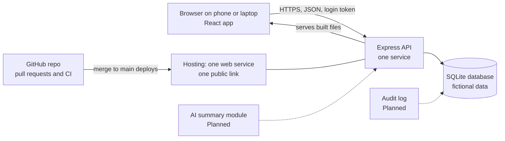

# System architecture

Owner: Kenneth. Draw this as one picture for the slides (Excalidraw, draw.io or Canva) and save the export here as `architecture.png`.

## Parts and their status

| Part | What it does | Status |
| --- | --- | --- |
| React app (Vite) | Screens for survivor, prevention user and clinician, three languages | Built |
| Express API | Sign in, roles, readings, plan, check in, education, summary | Built |
| SQLite database | Stores users, readings, plans, check ins, education items | Built, fictional data only |
| One service for API and app | One build, one public link, no cross origin setup | Built |
| CI on GitHub | Runs tests and the build on every pull request | Built |
| Login rate limit | Slows repeated wrong passwords | Planned until Axel adds it |
| Audit log | Records who saw what | Planned |
| AI assisted weekly summary | Descriptive only, no diagnosis | Planned |
| Clinician alerts | Notify a clinician about a patient | Planned |
| Encryption at rest, backups, monitoring | Needed before any real data | Planned |

## Why this stack

* One language (JavaScript) across the stack, so any teammate can read any file.
* One service to host, so the public link is simple to run and to recover.
* SQLite needs no separate database server for a demo. A move to PostgreSQL is a Planned step before any real use.
* The proposal said the stack would follow team skills and delivery time. This choice does.

## What travels on each arrow

* Browser to API: a JSON request and, after sign in, a login token in the `Authorization` header.
* API to database: parameterised queries only. No query is built from user text.
* API to browser: JSON, or the built app files for any page that is not `/api`.
