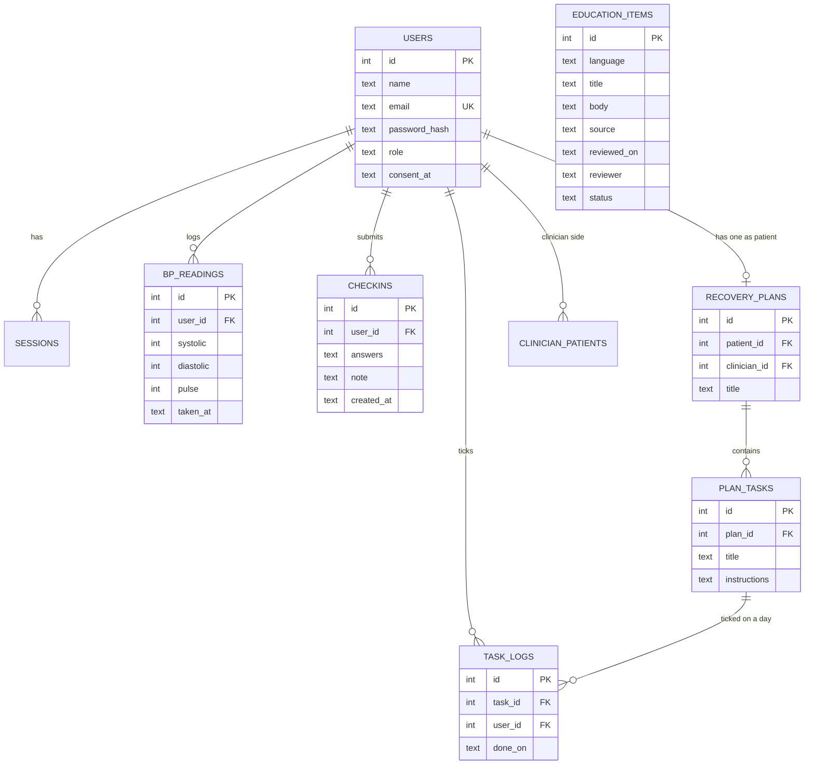

# Database structure

Owner: Axel, with Kenneth. This matches `backend/src/db.js`. If you change one, change the other.

## Decisions

* **Consent** is a `consent_at` column on `users` for now. A separate consent table with versions is Planned.
* **Roles** are a column on `users`. The check allows `admin`, but no admin screen exists yet.
* **Passwords** are stored as a salted scrypt hash, never as text.
* **Sessions** are random tokens with an expiry date, stored in `sessions`.
* **One active plan per patient.** `recovery_plans.patient_id` is unique. Plan history is Planned.
* **Task ticks** are one row per task per day. The pair `(task_id, done_on)` is unique.
* **Check in answers** are stored as JSON text so the ten questions can change without a new table.
* **Personal data fields:** `name`, `email`, readings, check in answers and notes. Treat these as personal data when real data is ever used.

## Planned tables, not created yet

`caregiver_links`, `alerts`, `appointments`, `audit_log`, `emergency_contacts`, `reminders`
